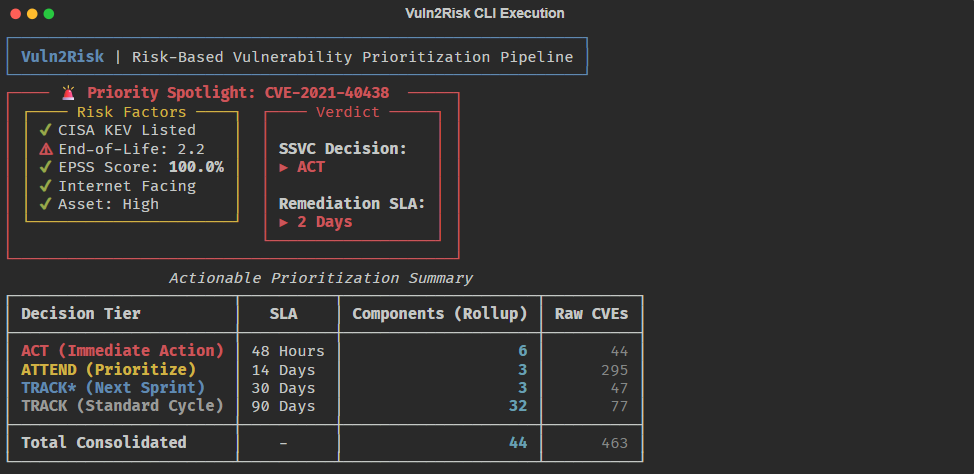
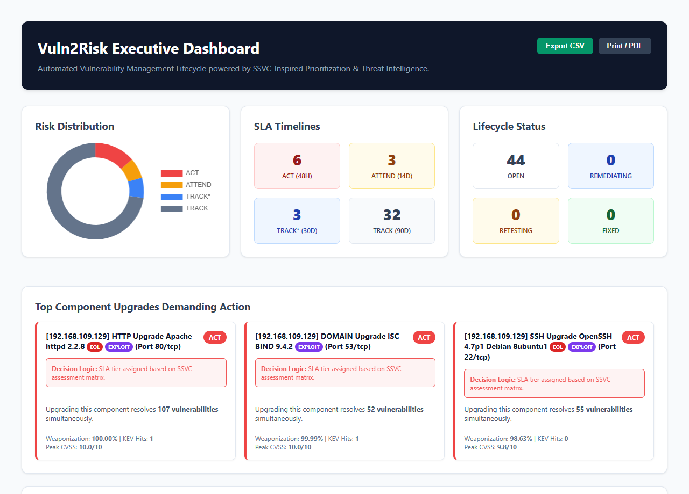
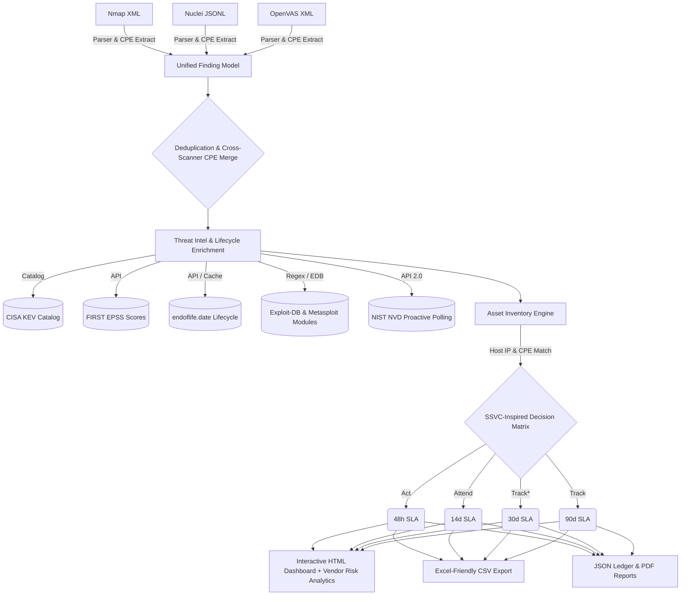

# Vuln2Risk: Risk-Based Vulnerability Prioritization Pipeline 🎯🛡️

[](https://github.com/alrightatharva/vuln2risk/actions/workflows/tests.yml)
[](https://opensource.org/licenses/MIT)
[](https://www.python.org/downloads/)

An open-source, explainable vulnerability triage pipeline that turns noisy, multi-scanner outputs into an actionable remediation backlog using real-world exploitability, asset exposure, Common Platform Enumeration (CPE), and an SSVC-inspired decision model.

CVSS alone does not reflect actual business risk. Vuln2Risk correlates raw scanner data with live threat intelligence, exploit catalogs, software lifecycle databases, and standardized asset inventories to produce defensible, SLA-driven patching decisions with full explainability.

---

## 🌟 The Impact: Signal Over Noise

In standard vulnerability scans, security teams face severe alert fatigue from hundreds of individual CVE notifications. Vuln2Risk correlates findings across hosts, ports, and software components:

In our benchmark test against Metasploitable lab scans (`sample_data/nmap_scan2.xml` + `sample_data/report1.json`):
* **463 Raw Findings** across Nmap and Nuclei.
* **44 Consolidated Component Upgrades** (grouped by Host + Service + Port).
* **Only 6 Components Require Immediate Action (ACT)** under live KEV, EPSS, and exploit intelligence.

<p align="center">
  
</p>

For every high-priority finding, Vuln2Risk provides a transparent "Priority Spotlight" justification so engineers know exactly *why* a patch is urgent:

* **✓ CISA KEV listed**
* **✓ EPSS: 100.0% exploitation probability**
* **✓ Internet-facing asset**
* **✓ High-criticality system**
* **Decision:** SSVC → ACT (48-hour SLA)

---

## 📊 Interactive Executive Dashboard

Vuln2Risk outputs a modern, presentation-ready executive report with interactive Chart.js visualizations, real-time client-side filters, and Excel-ready exports:

<p align="center">
  
</p>

*   **Risk Distribution Doughnut:** Visualizes overall backlog split across ACT, ATTEND, TRACK*, and TRACK.
*   **SLA & Lifecycle Counters:** Instant metrics on open, remediating, retesting, and resolved components.
*   **Top Component Spotlights:** Side-by-side cards highlighting the highest-risk upgrades that resolve the most vulnerabilities simultaneously.
*   **Vendor Risk Analytics:** Horizontal stacked bar chart identifying the riskiest software vendors across the environment.
*   **Interactive Backlog Table:** Searchable by service, port, vendor, or CVE with one-click UTF-8 BOM CSV download.

> [!NOTE]
> **Chart Rendering & Connectivity:** The interactive dashboard loads Chart.js pinned to `v4.4.7` via CDN (`cdn.jsdelivr.net`). Opening the HTML report in a browser requires an internet connection to fetch the charting library and render the graphs.

---

## 🎯 The SSVC-Inspired Decision Framework

### Why "SSVC-Inspired"?
The official Carnegie Mellon SEI / CISA Stakeholder-Specific Vulnerability Categorization (SSVC) framework relies on five decision dimensions: *Exploitation*, *Automatable*, *Technical Impact*, *Mission Prevalence*, and *Public Well-Being Impact*.

In an automated scanner pipeline, human-evaluated organizational impact variables (like *Public Well-Being*) cannot be extracted from technical XML/JSON scan dumps. Vuln2Risk operationalizes core SSVC principles into an automated, defensible triage tree:

1. **Exploitation:**
   - **Active:** Listed in CISA KEV, verified public weaponization (Metasploit / Exploit-DB), or FIRST EPSS >= 0.50.
   - *Why the 0.50 EPSS threshold?* In threat intelligence research, an EPSS probability ≥ 50% places a vulnerability in the top 5% of all CVEs by exploitation probability, demonstrating near-certain adversary targeting.
2. **Exposure:**
   - Evaluated via `--internet-facing` DMZ flags or network boundary rules in `--inventory`.
3. **Mission Impact & Asset Criticality:**
   - Standardized via `--inventory` host and CPE rules (`Critical`, `High`, `Medium`, `Low`).
4. **Lifecycle Debt (EOL):**
   - Integrates `endoflife.date` to escalate unsupported components that can never receive upstream security updates.

### Decision Tiers & Remediation SLAs
* 🚨 **ACT (48-Hour SLA):** Actively exploited vulnerabilities on internet-facing/critical systems or unsupported EOL assets.
* ⚠️ **ATTEND (14-Day SLA):** Actively exploited internal systems, or exposed EOL tech debt.
* 🔷 **TRACK\* (30-Day SLA):** High CVSS (≥ 7.0) on exposed systems or unpatched internal EOL tech debt.
* 📋 **TRACK (90-Day SLA):** Routine maintenance backlog.

---

## 🧠 System Architecture



---

## ✨ Key Features

1. **CPE 2.2 & 2.3 Extraction & Matching Engine:**
   * Automatically extracts and normalizes Common Platform Enumeration (CPE) strings (e.g., `cpe:/a:apache:http_server:2.2.8` or `cpe:2.3:a:vsftpd_project:vsftpd:2.3.4:*`).
   * Provides component-level parsing (vendor, product, version, update, part) and wildcard matching.

2. **Standardized Asset Inventory (`--inventory`):**
   * Supports matching asset rules by **Host IP/FQDN** and/or **CPE pattern/prefix**.
   * Allows security teams to set criticality and exposure by software stack (e.g. `cpe:/a:apache:http_server` -> `Critical`) without relying solely on static IP lists.

3. **Software Lifecycle & EOL Tracking:**
   * Automatically flags unsupported, discontinued, and End-of-Life software versions using the `endoflife.date` API with local caching (`cache/eol/`).
   * Includes built-in offline lifecycle heuristics for core enterprise software (Apache HTTP, OpenSSH, PHP, MySQL, Linux Kernel, vsftpd).

4. **Exploit & Weaponization Intelligence:**
   * **Scanner Evidence Extraction:** Uses regex patterns to detect Metasploit module paths (`rapid7.com/db/modules/...`), Exploit-DB IDs (`exploit-db.com/exploits/...`), and PacketStorm references directly in scan output.
   * **Exploit-DB Catalog Synchronization:** Run `--sync-exploitdb` to download and index the latest Exploit-DB mapping database (`files_exploits.csv`), cached in `cache/exploitdb/`.
   * **Curated High-Impact Catalog:** Built-in mapping of verified weaponized exploits for common enterprise and lab CVEs as an instant offline baseline.

5. **Proactive NVD 2.0 Polling (`--proactive-nvd`):**
   * Uses discovered CPEs to query the NIST NVD API 2.0 (`cache/nvd/`), uncovering zero-days and newly disclosed CVEs that scanner signatures have not yet added.

6. **Executive Dashboard & Vendor Risk Analytics:**
   * Interactive HTML dashboard with Chart.js risk distributions and SLA metrics.
   * **Vendor Risk Analytics:** Horizontal stacked bar chart and breakdown table aggregating vulnerabilities, CVE counts, EOL alerts, and weaponization across software vendors.
   * Component Backlog table with client-side search, SLA filtering, and one-click UTF-8 BOM CSV export for Excel.

---

## 🚀 Installation & Setup

Ensure you have Python 3.10+ installed.

```bash
# 1. Clone the repository
git clone https://github.com/alrightatharva/vuln2risk.git
cd vuln2risk

# 2. (Optional) Create and activate virtual environment
python -m venv venv
# Windows:
.\venv\Scripts\activate
# Linux/macOS:
source venv/bin/activate

# 3. Install dependencies
pip install -r requirements.txt
```

> [!NOTE]
> PDF generation via `--pdf` uses `pdfkit`, which requires [wkhtmltopdf](https://wkhtmltopdf.org/) installed on your system PATH (`apt-get install wkhtmltopdf` on Debian/Ubuntu, or via chocolatey / brew).

---

## 💻 Usage & CLI Reference

### 1. Basic Multi-Scanner Ingestion
Ingest Nmap and Nuclei scan files with global criticality and exposure flags:
```bash
python vuln2risk.py --nmap sample_data/nmap_scan2.xml --nuclei sample_data/report1.json --criticality High --internet-facing --csv
```

### 2. CPE & Host-Based Inventory Matching
Map assets and software stacks against an asset inventory:
```bash
python vuln2risk.py --nmap sample_data/nmap_scan.xml --inventory sample_data/inventory_sample.json --csv
```

### 3. Proactive NVD Zero-Day Discovery & Exploit-DB Sync
Query NIST NVD 2.0 API with discovered CPEs and synchronize the Exploit-DB catalog:
```bash
python vuln2risk.py --nmap sample_data/nmap_scan.xml --inventory sample_data/inventory_sample.json --proactive-nvd --sync-exploitdb --csv
```

### Command Line Arguments

| Argument | Type | Default | Description |
|---|---|---|---|
| `--nmap` | `str` | `None` | Path to Nmap XML output file (`-sV -oX`) |
| `--nuclei` | `str` | `None` | Path to Nuclei JSONL output file (`-j -o`) |
| `--openvas` | `str` | `None` | Path to OpenVAS / GVM XML report file |
| `--inventory` | `str` | `None` | Path to Asset Inventory JSON file (supports Host and CPE rules) |
| `--proactive-nvd`| `flag` | `False` | Query NIST NVD 2.0 API using discovered CPEs to discover unpatched CVEs |
| `--sync-exploitdb`| `flag` | `False` | Download latest Exploit-DB vulnerability mapping CSV (`files_exploits.csv`) into local cache |
| `--criticality` | `choice` | `Medium` | Fallback asset criticality (`Low`, `Medium`, `High`, `Critical`) |
| `--internet-facing` | `flag` | `False` | Global flag indicating assets are WAN-exposed |
| `--report-id` | `str` | `Hostname_Timestamp` | Custom identifier for output report filenames |
| `--csv` | `flag` | `False` | Export findings ledger to Excel-friendly CSV (`utf-8-sig` with full quoting) |
| `--pdf` | `flag` | `False` | Render HTML dashboard to PDF (requires `pdfkit` and `wkhtmltopdf`) |

---

## 📋 Asset Inventory Configuration (`inventory.json`)

The `--inventory` argument accepts a JSON file defining host and/or CPE rules. CPE rules allow you to specify risk parameters by software product or vendor wildcard:

```json
{
  "hosts": {
    "192.168.109.129": {
      "criticality": "High",
      "internet_facing": true,
      "owner": "SecOps",
      "tags": ["dmz", "production-edge"]
    }
  },
  "cpes": {
    "cpe:/a:apache:http_server": {
      "criticality": "Critical",
      "internet_facing": true,
      "tags": ["web-gateway"]
    },
    "cpe:/a:vsftpd:vsftpd": {
      "criticality": "Critical",
      "tags": ["ftp-service"]
    },
    "cpe:/a:openbsd:openssh": {
      "criticality": "High",
      "tags": ["remote-mgmt"]
    }
  }
}
```

*Precedence:* CPE rules can elevate criticality or define software-specific internet exposure, merging with host-level network boundaries.

---

## 🔑 Environment Variables (Optional)

| Variable | Description |
|---|---|
| `NVD_API_KEY` | NIST NVD API key. Increases query rate limits from 5 requests / 30s to 50 requests / 30s during proactive polling. |
| `PYTHONIOENCODING` | Set to `utf-8` on legacy Windows terminals (`$env:PYTHONIOENCODING="utf-8"`). |

---

## 🐳 Docker Deployment

Vuln2Risk can be executed inside an isolated container with volume mounting:

```bash
# Build the Docker image
docker build -t vuln2risk .

# Run container with volume mapping (PowerShell)
docker run --rm `
  -v ${PWD}/sample_data:/app/sample_data `
  -v ${PWD}/reports:/app/reports `
  vuln2risk --nmap sample_data/nmap_scan.xml --inventory sample_data/inventory_sample.json --csv
```

---

## 🧪 Testing

The 24-test suite validates CPE parsing, scanner extraction, inventory matching, component rollup consolidation, EOL lifecycle detection, exploit correlation, and SSVC decision logic:

```bash
pytest
```

---

## 📂 Project Structure

```text
vuln2risk/
├── .github/
│   └── workflows/
│       └── tests.yml       # GitHub Actions CI workflow (Python 3.10, 3.11, 3.12)
├── vuln2risk.py            # CLI entrypoint and pipeline orchestrator
├── core/
│   ├── cpe.py              # CPE 2.2/2.3 parser, normalizer & matcher
│   ├── inventory.py        # Host & CPE-based asset inventory manager
│   ├── models.py           # Unified Finding model, Enums, and properties
│   └── enricher.py         # Threat intelligence & lifecycle coordinator
├── parsers/
│   ├── nmap.py             # Nmap XML parser with CPE service extraction
│   ├── nuclei.py           # Nuclei JSONL parser with classification CPE extraction
│   └── openvas.py          # OpenVAS XML parser with NVT CPE extraction
├── enrichment/
│   ├── eol.py              # endoflife.date API client & offline lifecycle DB
│   ├── exploit.py          # Metasploit, Exploit-DB & weaponization engine
│   └── nvd.py              # NIST NVD API 2.0 proactive polling client
├── ssvc/
│   └── decision.py         # SSVC decision tree with EOL & exploit escalations
├── reporters/
│   └── generator.py        # HTML executive dashboard & Vendor Risk Analytics
├── tests/
│   └── test_pipeline.py    # Consolidated unit test suite (24 passing tests)
├── docs/
│   └── screenshots/        # High-resolution dashboard and terminal previews
├── sample_data/            # Sample scanner outputs and inventory templates
├── Dockerfile              # Container deployment instructions
└── requirements.txt        # Project dependencies
```

---

## 📜 License

This project is licensed under the MIT License. See [LICENSE](LICENSE) for details.
